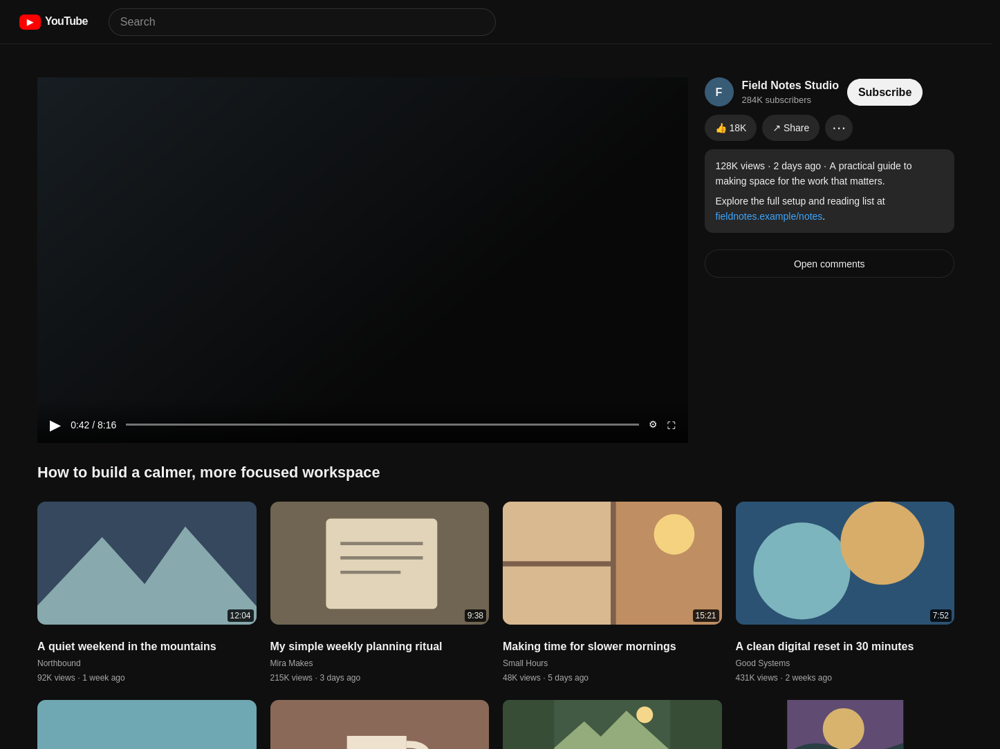

# YouTube Focus

YouTube Focus is a browser extension for Zen and Firefox 142 or newer. On desktop YouTube watch pages, it places the large player on the left with the video title and the recommendation grid below it, and keeps YouTube's channel, actions, and description together on the right. The grid has no heading, so the page stays calm. Narrow windows use a responsive layout, and YouTube's theatre and fullscreen modes remain available.

Comments start closed and reset to closed when you move to another video. Open them from the video details or extension popup; close them with the native close control or Escape. The popup also enables or disables the layout and sets recommendation cards to compact, comfortable, or large. Settings stay in local browser storage; the extension has no telemetry, backend, or account key.

Scroll within the comments to read the thread without moving the page. The comments header stays visible, and you can focus the thread with Tab and scroll with PageDown. Expanded descriptions leave space for the comments body.

In theatre mode, recommendations start directly below the title in the left column while the details sidebar stays alongside them, without pushing the grid down.



*Extension screenshot from the automated watch-page test fixture; the video and recommendations are sample content.*

## Install temporarily

Download [`youtube-focus-1.2.1.zip`](https://github.com/sambhavvk/youtube-focus/releases/download/v1.2.1/youtube-focus-1.2.1.zip), or clone this repository and build it locally.

1. Open `about:debugging#/runtime/this-firefox` in Zen or Firefox.
2. Choose **Load Temporary Add-on…**.
3. Select the downloaded ZIP, `manifest.json` from this project, or `artifacts/youtube-focus-1.2.1.zip` after building.
4. Open or refresh a YouTube video.

Temporary add-ons are removed when the browser restarts. The release ZIP is unsigned; permanent installation requires Mozilla signing. This is not a Chrome Web Store or Mozilla Add-ons listing.

## Build and checks

Use Node.js 22 and Python, then run:

```sh
npm ci
npm run build
npm run lint
npm test
npm run test:live
```

The build creates `artifacts/youtube-focus-1.2.1.zip` from an explicit file allowlist; development dependencies are only used to build and check the extension. The isolated browser tests use a fresh profile, not your existing Zen session. They select `/opt/zen-browser-bin/zen-bin` on Linux when available, then Firefox. Set `YF_BROWSER_BINARY` or `YF_GECKODRIVER` to provide explicit browser or GeckoDriver paths; otherwise GeckoDriver is taken from Selenium's cache when available.

YouTube can change its page markup, and account or layout variants may need maintenance.
